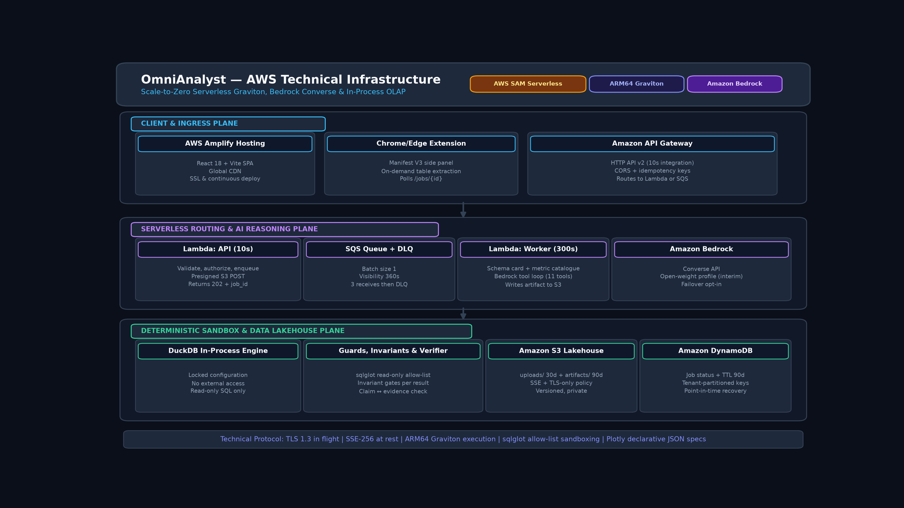

# 🦁 OmniAnalyst

**A deterministic, multi-disciplinary data analyst on AWS Bedrock.**

OmniAnalyst answers business questions about a dataset (CSV/Parquet) without letting the
language model do arithmetic. Bedrock plans the analysis and writes SQL; a locked DuckDB
sandbox executes it; typed statistical functions handle the specialised metrics; and every
number in the final narrative has to come from a tool result.

The workload is asynchronous by design: the HTTP API validates and enqueues, an SQS worker
does the multi-second analysis, and the client polls a job record for the result.

> ⚠️ **Deployment status.** This is a hardened pre-production baseline. Authentication is
> **not implemented yet** — every unauthenticated caller shares the isolated `public`
> workspace (see [Known limitations](#-known-limitations-before-production)). The Bedrock
> tool loop, the SQL guard and the DuckDB sandbox are verified against the live API; the
> container image has not been built in the authoring environment.

---

## Contents

- [Architecture](#-architecture)
- [Request lifecycle](#-request-lifecycle)
- [API reference](#-api-reference)
- [Determinism and safety model](#-determinism-and-safety-model)
- [Analytical disciplines](#-analytical-disciplines)
- [Repository structure](#-repository-structure)
- [Local development](#-local-development)
- [Deployment](#-deployment)
- [Configuration](#-configuration)
- [Operations](#-operations)
- [Testing](#-testing)
- [Known limitations before production](#-known-limitations-before-production)
- [License](#-license)

---

## 🏛 Architecture



```mermaid
flowchart TB
    SPA["React 18 SPA<br/>(AWS Amplify + CloudFront)"]
    EXT["Chrome/Edge MV3<br/>side panel"]
    APIGW["Amazon API Gateway<br/>HTTP API"]
    API["Lambda: API<br/>10s · 512 MB"]
    Q["SQS analysis queue<br/>+ DLQ (3 receives)"]
    WK["Lambda: Worker<br/>300s · 3008 MB"]
    BR["Amazon Bedrock<br/>Converse API"]
    S3[("S3 lakehouse<br/>uploads/ + artifacts/")]
    DDB[("DynamoDB<br/>jobs table, TTL 90d")]

    SPA -->|presigned POST| S3
    SPA --> APIGW
    EXT --> APIGW
    APIGW --> API
    API -->|202 + job_id| SPA
    API -->|SendMessage| Q
    API -->|queue job record| DDB
    API -->|presign| S3
    Q --> WK
    WK -->|load dataset| S3
    WK --> BR
    WK -->|write result.json| S3
    WK -->|status + result_key| DDB
    SPA -->|poll GET /jobs/{id}| APIGW
    APIGW --> DDB
```

Key properties:

| Concern | Implementation |
| --- | --- |
| Compute | Two container-image Lambdas from one Docker image (`arm64` by default) |
| Long analyses | SQS worker with a 300 s budget and a dead-letter queue |
| Idle cost | Scale-to-zero: no NAT gateway, no always-on compute |
| Dataset storage | S3, server-generated keys, SSE, TLS-only bucket policy, short lifecycle |
| Job state | DynamoDB on-demand, tenant-partitioned, TTL-expired |
| Result storage | S3 JSON artifact (DynamoDB items are capped at 400 KB) |
| Frontend | Static React 18 + Vite bundle on Amplify Hosting with a CSP |

Diagrams (PNG + SVG + Mermaid) live in [`generated-diagrams/`](generated-diagrams/) and are
produced by [`scripts/generate_diagrams.py`](scripts/generate_diagrams.py):

- `architecture_overview.*` — stakeholder-level workflow
- `detailed_infrastructure.*` — the AWS resource map above
- `data_flow_architecture.*` — the execution pipeline and statistical gates
- `determinism_contract.*` — planner/executor separation, plan IR and the five rules
- `mermaid-*.md` — the same diagrams as Mermaid sources (render on GitHub / editors)
- `index.html` — open locally to view every artifact in one page

---

## 🔄 Request lifecycle

1. **Upload.** `POST /upload/presign` returns a size-capped presigned POST and a
   server-generated key of the form `uploads/{tenant}/{uuid}.{csv|parquet}`. The browser
   uploads straight to S3; the dataset never passes through Lambda.
2. **Submit.** `POST /analyze` validates the payload, resolves the tenant, confirms the
   object actually exists in S3, writes a `QUEUED` job to DynamoDB, and sends one SQS message.
   It returns `202` with a `job_id` in milliseconds. `POST /query` follows the same path for a
   single read-only SQL statement.
3. **Execute.** The worker loads the dataset from S3, registers it as the DuckDB table
   `dataset`, runs the Bedrock tool loop, then writes the full result to
   `artifacts/{tenant}/{job_id}/result.json`.
4. **Complete.** The job record moves to `COMPLETED` with a `result_key` (or `FAILED` with a
   machine-readable error code).
5. **Poll.** `GET /jobs/{job_id}` returns status plus the result body once the artifact exists.

Failures are split by cause. A permanent problem (rejected SQL, unreachable model, empty
dataset) marks the job `FAILED` immediately and is **not** retried. An unexpected error is
recorded as `RETRYING` and re-raised, so the client keeps polling instead of seeing a terminal
failure for a job that is about to run again; only the final delivery (three attempts, matching
the queue's `maxReceiveCount`) writes `FAILED`, and the DLQ then captures the poison message.
A redelivery of an already-finished job is skipped, so at-least-once delivery cannot re-bill
Bedrock or overwrite a result.

Sending `x-idempotency-key` makes submission idempotent: the job id is derived from the key
plus the whole normalized payload (query or SQL, dataset key, model, discipline, chart request),
so a retried request returns the same job instead of running the analysis twice, while the same
key used against a different dataset correctly starts a new job. If the queue publish fails, the
job row is removed again so the retry can succeed.

---

## 🔌 API reference

Base URL: `https://<api-id>.execute-api.<region>.amazonaws.com/<stage>`

| Method | Path | Purpose | Success |
| --- | --- | --- | --- |
| `GET` | `/health` | Liveness, build metadata, config sanity | `200` |
| `POST` | `/upload/presign` | Presigned S3 POST for a dataset | `200` |
| `POST` | `/analyze` | Queue a natural-language analysis | `202` |
| `POST` | `/query` | Queue one read-only SQL statement | `202` |
| `GET` | `/jobs/{job_id}` | Job status and result | `200` |

<details>
<summary><strong>POST /upload/presign</strong></summary>

```json
{ "filename": "sales.csv", "size": 2048, "content_type": "text/csv" }
```

```json
{
  "upload_url": "https://...",
  "upload_fields": { "key": "uploads/public/<uuid>.csv", "Content-Type": "text/csv", "...": "..." },
  "dataset_key": "uploads/public/<uuid>.csv",
  "expires_in": 900,
  "max_bytes": 2048
}
```

`max_bytes` is `min(requested size, MAX_UPLOAD_BYTES)`; the presigned policy enforces it.
</details>

<details>
<summary><strong>POST /analyze</strong></summary>

```json
{
  "query": "What is Net Revenue Retention by cohort?",
  "dataset_key": "uploads/public/<uuid>.csv",
  "discipline": "Financial & RevOps",
  "model_id": "global.moonshotai.kimi-k3",
  "chart_type": "bar",
  "chart_columns": { "x": "cohort", "y": "nrr" },
  "generate_chart": true
}
```

`discipline` accepts either the display name (`"Financial & RevOps"`) or the key (`"financial"`).
`chart_type` may be omitted — it is inferred from the result columns.

```json
{ "status": "QUEUED", "job_id": "<uuid>", "poll": "/jobs/<uuid>" }
```

Alternatively, pass `page_context` (a table extracted by the browser extension) instead of
`dataset_key`.
</details>

<details>
<summary><strong>GET /jobs/{job_id}</strong></summary>

```json
{
  "job_id": "<uuid>",
  "status": "COMPLETED",
  "mode": "analyze",
  "created_at": 1760000000,
  "updated_at": 1760000012,
  "attempts": 1,
  "usage": { "input_tokens": 4120, "output_tokens": 640, "total_tokens": 4760 },
  "result": { "analysis": "...", "chart_spec": { "data": [], "layout": {} }, "tool_executions": [] }
}
```

`status` is one of `QUEUED`, `RUNNING`, `RETRYING`, `COMPLETED`, `FAILED`. `RETRYING` is
non-terminal: keep polling until a worker succeeds or the final attempt fails.
</details>

**Error envelope.** Every failure returns the same shape, and internal detail stays in the logs:

```json
{
  "error": {
    "code": "INVALID_DATASET_KEY",
    "message": "The dataset key is not valid for this workspace.",
    "request_id": "…",
    "retryable": false
  }
}
```

Codes include `BAD_REQUEST`, `FORBIDDEN`, `NOT_FOUND`, `PAYLOAD_TOO_LARGE`,
`INVALID_DATASET_KEY`, `INVALID_CHART_COLUMNS`, `DATASET_REQUIRED`, `DATASET_NOT_FOUND`,
`UNKNOWN_FIELDS`, `MODEL_NOT_APPROVED`, `BEDROCK_THROTTLED`, `MODEL_ACCESS_DENIED`,
`BEDROCK_UNAVAILABLE`, `INTERNAL`. Query failures surface on the job as `QUERY_REJECTED` (the
statement was blocked by the SQL allow-list) or `SQL_EXECUTION_ERROR` (the engine rejected it,
which usually means a wrong table or column).

---

## 🔬 Determinism and safety model

The model is treated as an untrusted planner. Three controls enforce that its output cannot
reach the network, the filesystem, or the operating system.

**1. SQL allow-list** — [`src/engine/sql_guard.py`](src/engine/sql_guard.py)

SQL is parsed with `sqlglot` before execution. Only a single read-only statement rooted at
`SELECT`/`WITH`/`UNION`/`INTERSECT`/`EXCEPT` is accepted. DDL, DML, `COPY`, `ATTACH`, `PRAGMA`,
`SET`, `INSTALL`, `LOAD`, `EXPORT` and friends are rejected by node type; file/network
functions (`read_csv`, `read_parquet`, `glob`, `http_get`, …) and URL or path literals are
rejected by name; table references that are really paths or URLs are rejected too.

**2. Locked engine** — [`src/engine/sandbox.py`](src/engine/sandbox.py)

DuckDB is opened with `enable_external_access=false`, extension autoloading disabled and
`lock_configuration=true`, so a query cannot re-enable either. The connection is in-memory
only, and results are capped at 5,000 rows with an explicit `truncated` flag.

**3. Typed tools only** — [`src/agent/bedrock_core.py`](src/agent/bedrock_core.py)

The model may call `execute_sql_query` plus a small set of typed discipline functions whose
arguments are JSON-schema validated. There is no arbitrary Python execution tool. Python
execution still exists in the sandbox for first-party callers, guarded by an AST allow-list
(blocked imports, dynamic execution, IO, dunder attributes) — but it is not reachable from
the model.

**Verification gates** — [`src/engine/invariants.py`](src/engine/invariants.py)

Every result set is checked automatically for sample size and high null rates, and the checks
travel with the result as warnings instead of being dropped. A one-row result is treated as an
aggregate — where a row-count threshold says nothing about the data behind it — rather than as
an under-powered sample. Probability-bound (`0 ≤ p ≤ 1`), non-negativity and arithmetic
reconciliation checks are available declaratively via `run_suite(df, rules=[...])` for callers
that know the expected relationship.

**Semantic layer** — [`src/semantic/`](src/semantic/)

Metric formulas are defined once in `src/semantic/catalog.json` (name, version, unit, formula,
required columns, aliases) and compiled to SQL. The model calls `query_metric` with a metric
name, grouping and typed filters; it never re-derives a catalogued formula. When a required
column is missing the metric is unavailable, not guessed. Derived metrics (e.g. `aov`) expand
recursively from versioned definitions.

**Schema card** — [`src/dataprof/schema_card.py`](src/dataprof/schema_card.py)

A deterministic dataset profile (dtype, inferred role, null rate, distinct count, range or top
values per column) is injected into the system prompt, so the planner uses real column names
and types instead of burning rounds on discovery queries. The card is token-bounded and
contains no row-level payload.

**Claim verification** — [`src/verify/claims.py`](src/verify/claims.py)

After the model writes the narrative, every number in it is extracted and matched against the
numbers the tools actually produced (0.5% tolerance, percent↔fraction aware, calendar years
excluded). The verdict rides on the job as `verification` (`PASS` / `REVIEW` / `NO_CLAIMS`)
and the frontend renders it, so unsupported numbers are visible instead of silent.

**Typed analysis plans** — [`src/plan/`](src/plan/)

A closed-schema `AnalysisPlan` (intent, metric, grouping, typed filters, grain, limits) with a
SHA-256 `plan_hash`, compiled deterministically to one guarded SQL statement. This is the
contract the Strands migration will emit via structured output.

**Model allow-list.** The API only accepts the model ids this build was verified against
(`global.moonshotai.kimi-k3`) plus whatever the deployment configures as primary, fallback or in
`BEDROCK_ALLOWED_MODELS`. Selection is an exact match, never a prefix match, and an id outside
the list fails fast with `MODEL_NOT_APPROVED` instead of queuing a job that cannot run. A model
that is allowed but not enabled in the account surfaces as `MODEL_ACCESS_DENIED` on the job.

**Model fallback** is opt-in and restricted to access/validation/availability errors
(`AccessDeniedException`, `ValidationException`, `ResourceNotFoundException`, …). Throttling is
retried by botocore with adaptive mode and never silently switches models mid-analysis. With
`BEDROCK_FALLBACK_MODEL` empty there is no failover at all — an unreachable second model would
only convert one error into another.

**Prompt-injection posture.** Dataset contents, extracted page text and tool output are framed
as untrusted data in the system prompt, and the model's only write capability is a SELECT.

---

## 📊 Analytical disciplines

Deterministic implementations live in [`src/disciplines/`](src/disciplines/). The model picks
from these tools; it never invents the formula.

| Discipline | Tools exposed to the model |
| --- | --- |
| **General** | `execute_sql_query`, `query_metric` (versioned semantic catalogue) |
| **Product** | `product_funnel_analysis` (sequential; ordered per-user when a user + timestamp are given), `product_retention_matrix` (completeness-flagged) |
| **Financial & RevOps** | `financial_arr_waterfall` (ARR movement, NRR/GRR, real reconciliation), `financial_runway_simulation` (seeded Monte Carlo, stated assumptions) |
| **Operations** | `operations_little_law`, `operations_lead_time_analysis` (empirical percentiles, optional SLA breach) |
| **Marketing & Growth** | `growth_attribution` (first/last/linear/position-based when a user + timestamp exist, otherwise explicitly a single-touch channel share), `growth_unit_economics` (LTV, LTV:CAC, payback) |
| **Clinical & Biotech** | `clinical_contingency_test` (odds ratio with Haldane-Anscombe, relative risk + interval, Fisher's exact, stated methods) |

Charts are generated server-side as declarative Plotly JSON from the table returned by the
model's last successful SQL statement, so a chart can never show numbers the analysis did not
produce. The frontend loads Plotly lazily, only when a chart exists.

---

## 📁 Repository structure

```text
AI_Data-Analytics_Agent/
├── src/
│   ├── lambda_function.py      # HTTP API: validate → enqueue → poll (10 s budget)
│   ├── worker.py               # SQS worker: run analysis → persist artifact (300 s)
│   ├── errors.py               # Client-safe error contract
│   ├── api/validation.py       # Payload limits, tenant resolution, key scoping
│   ├── storage.py              # S3 keys, presigned POST, artifact IO
│   ├── repository.py           # DynamoDB job records
│   ├── services/analysis.py    # Shared analyze/SQL pipeline + chart inference
│   ├── agent/bedrock_core.py   # Bedrock Converse loop, typed tools, fallback policy
│   ├── engine/
│   │   ├── sql_guard.py        # sqlglot read-only allow-list
│   │   ├── sandbox.py          # Locked DuckDB + AST-guarded Python
│   │   └── invariants.py       # Statistical and arithmetic gates
│   ├── disciplines/            # product, financial, operations, growth, clinical
│   ├── semantic/               # Versioned metric catalogue + deterministic SQL
│   ├── plan/                   # Typed analysis plans (Analyst IR) + compiler
│   ├── dataprof/               # Deterministic schema card injected before planning
│   ├── verify/                 # Narrative claim verification against tool outputs
│   ├── ingest/                 # OCR (RapidOCR), document intake, RAG chunking
│   ├── rag/                    # Semantic RAG: S3 Vectors + Bedrock embeddings
│   └── core/
│       ├── data_handler.py     # S3 → DataFrame (CSV/Parquet/Excel, lazy engines)
│       └── visualizations.py   # Plotly spec generation with column validation
├── frontend/                   # React 18 + Vite SPA
├── extension/                  # Manifest V3 side panel (on-demand injection, vendored Plotly)
├── tests/                      # pytest suite (API contract, sandbox, validation)
├── scripts/
│   ├── seed_sample_data.py     # Deterministic sample dataset → S3
│   ├── verify_bedrock_access.py# Preflight model/inference-profile access
│   ├── smoke_bedrock_agent.py  # Real Bedrock + DuckDB run, no AWS infra needed
│   └── generate_diagrams.py    # Regenerates generated-diagrams/
├── template.yaml               # SAM stack (API, worker, SQS+DLQ, S3, DynamoDB)
├── Dockerfile                  # Shared Lambda container image
├── amplify.yml                 # Amplify build (repo root is the app root)
├── customHttp.yml              # CSP and security response headers
├── requirements.txt            # Runtime dependencies (image)
├── requirements-dev.txt        # Test/lint tooling (never shipped)
└── pyproject.toml              # pytest, ruff, coverage configuration
```

---

## 💻 Local development

Prerequisites: Python 3.12, Node 20+, and — for container builds — Docker.

```bash
# Backend: install, lint, test
python -m pip install -r requirements-dev.txt
python -m ruff check src tests scripts
python -m pytest

# Frontend
cd frontend
npm ci
npm run dev        # http://localhost:3000
npm run build      # production bundle in dist/
```

The frontend reads `VITE_API_ENDPOINT` at build time; copy
[`frontend/.env.example`](frontend/.env.example) to `frontend/.env.local` for local work. In
development the endpoint can also be set from the in-app settings panel (stored in
`localStorage`); production builds only use the environment variable.

The backend has no local HTTP server: `lambda_function.lambda_handler(event, context)` is the
entry point, and `tests/test_api_contract.py` exercises it end-to-end against mocked AWS.

---

## 🚀 Deployment

### 1. Backend (AWS SAM)

```bash
# Verify Bedrock model access first — model ids differ per region/account
python scripts/verify_bedrock_access.py --region us-east-1

# Prove the model + tool loop + DuckDB work before building anything
python scripts/smoke_bedrock_agent.py

sam validate --lint
sam build
sam deploy --guided
```

`smoke_bedrock_agent.py` makes a real Converse call with the real SQL tools against
an in-memory DuckDB table, so it catches model-access and capability problems (unsupported
sampling parameters, missing tool support) without deploying a stack.

`sam build` builds the container image with Docker, so the daemon must be running and the
build host needs roughly 10 GB of free disk (scipy, pyarrow, polars, duckdb, plotly).

Answer the guided prompts, or supply overrides:

| Parameter | Default | Notes |
| --- | --- | --- |
| `Environment` | `dev` | Also the API stage name |
| `AllowedOrigin` | `http://localhost:5173` | Exact SPA origin; set to your Amplify domain |
| `BedrockModelId` | `global.moonshotai.kimi-k3` | Interim model, verified with Converse + tool use in `us-east-1` |
| `BedrockFallbackModelId` | empty | Optional second model; empty disables failover |
| `LambdaArchitecture` | `arm64` | Switch to `x86_64` if the build host cannot cross-build arm64 |
| `AppVersion` | `0.1.0` | Surfaced by `/health` |

The stack creates: HTTP API, two Lambdas, SQS queue + DLQ, S3 lakehouse bucket, DynamoDB jobs
table. `sam deploy` prints `ApiEndpoint`, `DataBucketName`, `JobsTableName` and
`AnalysisQueueUrl`.

Optionally seed a sample dataset (the printed key is accepted by `/analyze`):

```bash
python scripts/seed_sample_data.py --bucket <DataBucketName> --tenant public
```

### 2. Frontend (AWS Amplify Hosting)

1. Connect the repository in the Amplify console.
2. Leave the **app root** as the repository root — [`amplify.yml`](amplify.yml) changes into
   `frontend/` in each phase and publishes `frontend/dist`.
3. Add the environment variable `VITE_API_ENDPOINT=https://<api-id>.execute-api.<region>.amazonaws.com/dev`.
4. Deploy. [`customHttp.yml`](customHttp.yml) is picked up automatically and applies the CSP,
   HSTS, `X-Frame-Options: DENY`, `nosniff` and a restrictive `Permissions-Policy`.

No SPA rewrite is required: the app has no client-side router.

### 3. Browser extension (Manifest V3)

1. Open `chrome://extensions` (or `edge://extensions`) and enable **Developer mode**.
2. **Load unpacked** → select the [`extension/`](extension/) directory.
3. Open the side panel, paste the **API base URL** (for example
   `https://abc123.execute-api.us-east-1.amazonaws.com/dev`), and save.
4. Extract a table from the active tab, ask a question, and wait for the polled result.

The extension injects `content.js` on demand (no persistent content script), vendors Plotly
locally because MV3 forbids remote scripts, and never sends an API key.

Extraction is bounded: each table contributes at most 200 sample rows, and the whole
`page_context` must fit `MAX_PAGE_CONTEXT_BYTES` (200 KB) because the job travels to the worker
over SQS. When a page reports more rows than were transmitted, the result says so
(`dataset.sampled`, `dataset.reported_row_count`). For a full dataset, upload the file instead.

---

## ⚙️ Configuration

Lambda environment variables are set by [`template.yaml`](template.yaml):

| Variable | Default | Purpose |
| --- | --- | --- |
| `DATA_BUCKET` | stack bucket | Lakehouse bucket for uploads and artifacts |
| `JOBS_TABLE` | stack table | DynamoDB job table |
| `ANALYSIS_QUEUE_URL` | stack queue | SQS queue the API enqueues to |
| `BEDROCK_PRIMARY_MODEL` / `BEDROCK_FALLBACK_MODEL` | template parameters | Model ids |
| `BEDROCK_ALLOWED_MODELS` | unset | Comma-separated extra ids a caller may request; the verified model plus the primary and fallback are always allowed |
| `ALLOWED_ORIGIN` | `http://localhost:5173` | CORS origin for the API and S3 |
| `MAX_UPLOAD_BYTES` | `52428800` (50 MB) | Presign size ceiling |
| `MAX_QUERY_CHARS` | `4000` | Natural-language query limit |
| `MAX_SQL_CHARS` | `20000` | SQL statement limit |
| `MAX_PAGE_CONTEXT_BYTES` | `200000` | Extension payload limit (UTF-8 bytes; kept under the 256 KB SQS body limit) |
| `JOB_TTL_DAYS` | `90` | DynamoDB TTL for job records; artifacts expire on the same clock |
| `MAX_RECEIVE_COUNT` | `3` | Deliveries before a job is marked `FAILED`; must match the queue's `maxReceiveCount` |
| `PRESIGN_EXPIRES_SECONDS` | `900` | Presigned POST lifetime |
| `LOG_LEVEL` | `INFO` | Powertools log level |

---

## 📈 Operations

- **Traces and metrics.** Powertools emits structured logs, X-Ray traces and the
  `DataAnalystAgent` EMF namespace (requests, client/server errors, job outcomes, durations).
  The API forwards `x-correlation-id` into the log context.
- **Queue health.** Alert on `ApproximateNumberOfMessagesVisible` on the main queue and on any
  message in the DLQ. `VisibilityTimeout` (360 s) is intentionally larger than the worker
  timeout (300 s).
- **Cost guardrails.** Worker concurrency is capped at 10 reserved executions, which bounds
  Bedrock and DuckDB spend during a burst. Uploads expire after 30 days and artifacts after 90
  (in step with `JOB_TTL_DAYS`), so a result cannot outlive its job record by design; if an
  artifact is gone anyway the API degrades to `RESULT_UNAVAILABLE` instead of erroring.
- **Data handling.** Bucket policy denies all non-TLS requests; public access is blocked; object
  ownership is `BucketOwnerEnforced`; SSE-AES256 is the default.
- **Rollback.** SAM keeps the previous Lambda versions; `sam deploy --no-execute-changeset`
  lets you review before applying.

---

## 🧪 Testing

```bash
python -m pytest -q
```

150 tests across twelve suites:

| Suite | Covers |
| --- | --- |
| `tests/test_api_contract.py` | Routing (including stage-prefixed paths), CORS, presign limits, payload-scoped idempotency, enqueue rollback, tenant isolation, worker completion/retry/duplicate-delivery handling, batch failure reporting, error envelope (moto-backed) |
| `tests/test_analysis_service.py` | Page-context datasets, `422` SQL rejection versus execution errors, Bedrock error-to-code mapping |
| `tests/test_agent.py` | Discipline formulas, invariant gates, aggregate-aware sample-size handling |
| `tests/test_sandbox_security.py` | 30 escape attempts: `COPY`, `ATTACH`, `INSTALL`, `PRAGMA`, path/URL literals, multi-statement SQL, dunder traversal, blocked imports |
| `tests/test_validation.py` | Dataset-key regex and cross-tenant access, payload limits (byte-measured page context), page-table selection, discipline/chart/model normalization and the exact model allow-list |
| `tests/test_model_fallback.py` | Failover stays off when unconfigured, switches only on access errors, never masks throttling, drops unsupported `temperature` |
| `tests/test_semantic.py` | Metric catalogue loading, binding (exact/alias/ambiguous/unavailable), deterministic SQL, sandbox execution of compiled queries |
| `tests/test_plan_ir.py` | Plan validation, hashing stability, aggregate/trend compilation, literal escaping, closed schema |
| `tests/test_dataprof.py` | Schema-card determinism, role inference (measure/dimension/temporal/identifier), bounded rendering |
| `tests/test_claims.py` | Number extraction (formats, percent, magnitudes), tolerance matching, year exclusion, zero-fact behaviour |
| `tests/test_disciplines_v2.py` | Sequential and ordered funnels, retention completeness, real attribution models, seeded runway, Haldane-Anscombe correction |
| `tests/test_ocr_ingest.py` | OCR line → table reconstruction, deterministic chunking, document dispatch, RapidOCR end-to-end on a synthetic image |
| `tests/test_rag.py` | Vector batching (500/put), metadata budget trimming, tenant-scoped filters, pipeline ingest/search with fake AWS clients |

Architecture decisions behind the new suites live in
[`docs/architecture/2026-10-determinism-contract.md`](docs/architecture/2026-10-determinism-contract.md) and
[`docs/architecture/2026-10-ocr-rag-discovery.md`](docs/architecture/2026-10-ocr-rag-discovery.md).

Quality gates:

```bash
python -m ruff check src tests scripts   # lint
python -m pytest --cov                   # coverage (threshold 60%)
```

---

## 🚧 Known limitations before production

These are deliberate, sequenced follow-ups — not oversights:

1. **No authentication or authorization.** The tenant is derived from a JWT `sub` claim when an
   authorizer is present, otherwise from the caller-controlled `x-tenant-id` header, otherwise
   `public`. Because that header is not verified, tenant isolation is currently **zero**: anyone
   with the API URL can act as any workspace and read its jobs. The dataset-key regex and job
   partition key enforce isolation only *after* an identity exists. Phase 1 adds a Cognito
   authorizer and per-user quotas; do not expose this deployment to untrusted callers before then.
2. **No WAF, rate limiting or budget alarm.** Only Lambda reserved concurrency limits spend.
3. **No KMS customer-managed key.** S3 and DynamoDB currently use AWS-managed/SSE-S3 keys.
4. **No Bedrock Guardrails.** Injection resistance relies on prompting plus the SQL allow-list.
5. **Single region.** No cross-region failover; the inference profile id determines routing. The
   static CSP in [`customHttp.yml`](customHttp.yml) names `us-east-1` hosts, so it must be updated
   if the stack is deployed elsewhere.
6. **The interim model is a stopgap.** Anthropic models return `ResourceNotFoundException`
   (“Model use case details have not been submitted”) for this account, so the default is
   `global.moonshotai.kimi-k3`, the only profile verified to accept Converse tool use here.
   Submit the Anthropic use-case details form, then redeploy with
   `--parameter-overrides BedrockModelId=global.anthropic.claude-sonnet-4-5-20250929-v1:0`.
   The allow-list is per deployment: enabling a model requires a redeploy, not just a client change.
   Always re-run `scripts/verify_bedrock_access.py` for your own account and region.
7. **Container build is unverified in this environment.** `sam validate --lint` passes, but the
   image has not been built here (no Docker daemon, limited disk). Build on a machine with a
   running Docker daemon and ~10 GB free.
8. **OCR/RAG modules are implemented but not yet wired to the API.** `src/ingest/` and
   `src/rag/` carry 16 tests with fake AWS clients; wiring (a document-ingest endpoint, an S3
   vector bucket + index in `template.yaml`, and the `requirements-ocr.txt` image layer) is
   Phase 5. The semantic index expects an `s3vectors` vector bucket and a Bedrock embedding
   model (`amazon.titan-embed-text-v2:0`, 512 dimensions) to exist.

---

## 📄 License

MIT. See [LICENSE](LICENSE).
