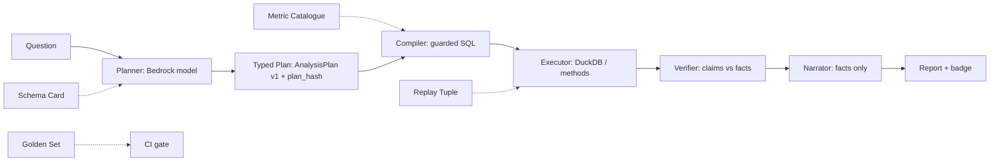

# OmniAnalyst — The Determinism Contract (Mermaid)

## The five rules

1. The planner never computes: every number comes from the executor.
2. The plan is a typed, hashed object; unknown keys are rejected.
3. Catalogued metrics compile to one versioned formula.
4. The narrator sees facts, not data; unsupported numbers are flagged.
5. Same dataset + same plan hash + same engine = same result.
